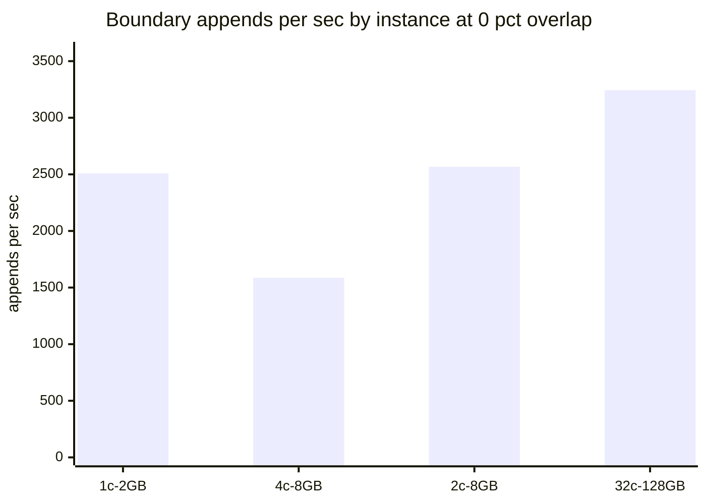
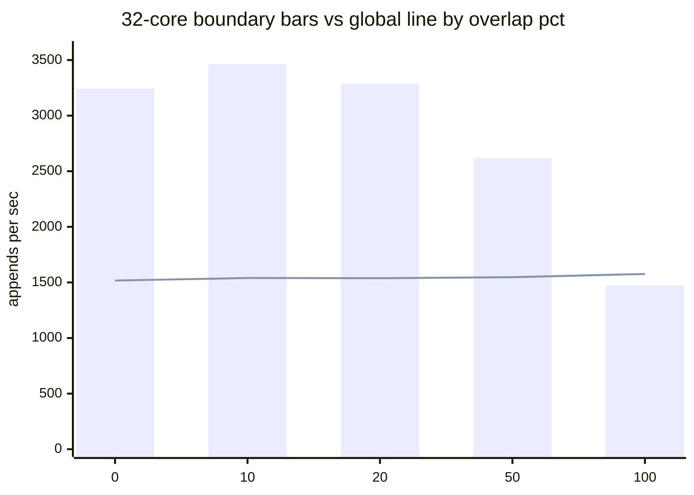
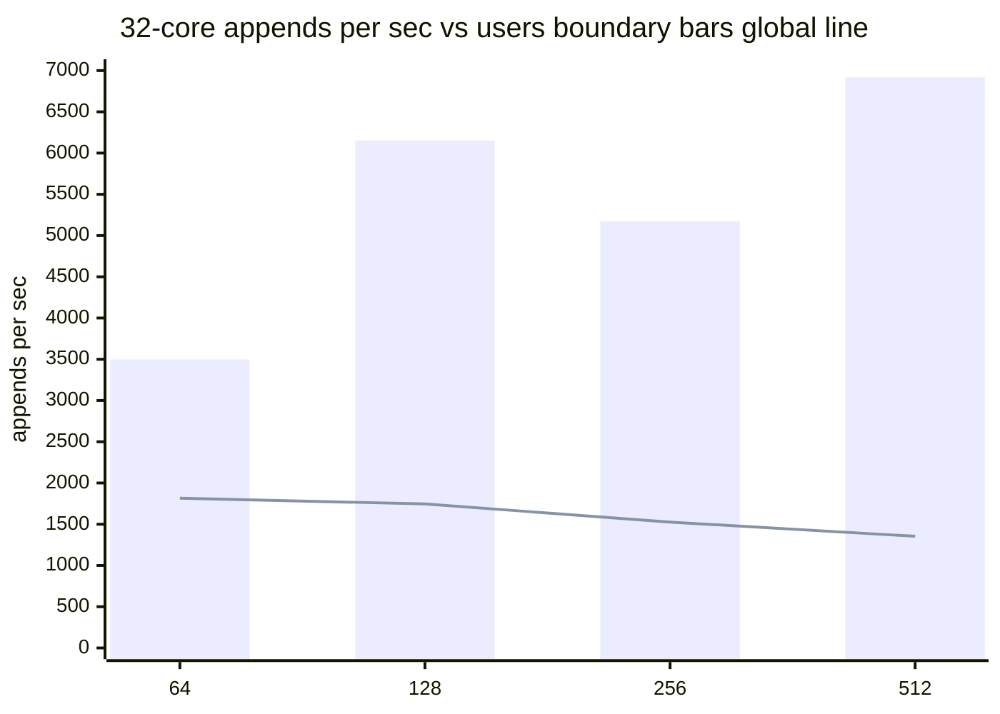
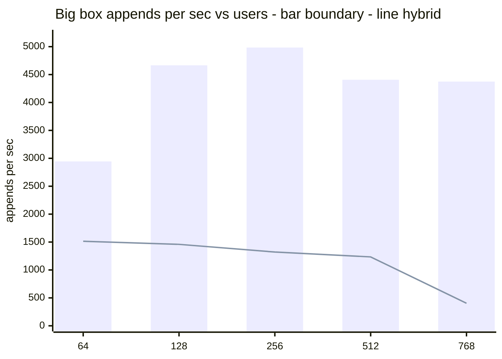
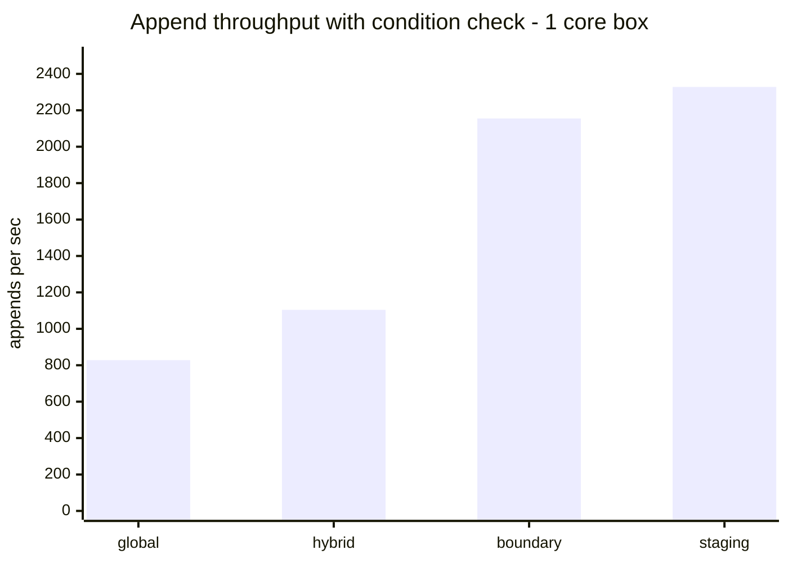
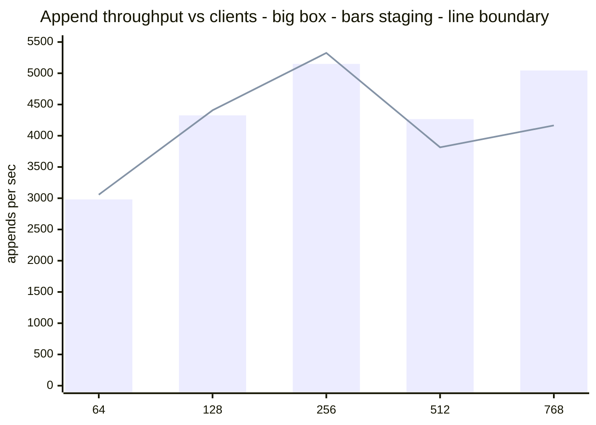

# appendbench — Conclusion: global lock vs per-boundary locks

**What was measured:** appends/second to a **10,000,000-event** PostgreSQL store on Scaleway
(~11 ms client↔DB round-trip), with a realistic DCB append (`condition=check`: the in-lock
condition check runs, but the decision-read is offloaded), **64 concurrent writers**, comparing:

- **global** — one global advisory lock (every append serializes), and
- **boundary** — per-`(type,tag,value)` advisory locks (appends to *different* entities run in parallel).

**Overlap** = the fraction of writes aimed at one shared "hot" boundary (0% = all writers on their
own entity; 100% = all writers on the same entity).

---

## Append rate (appends/s) — GLOBAL lock

| instance | 0% | 10% | 20% | 50% | 100% |
|----------|---:|----:|----:|----:|-----:|
| 1 core / 2 GB        | 1253 | 1252 | 1381 | 1326 | 1267 |
| 4 core / 8 GB †      |  367 |  391 |  388 |  386 |  372 |
| 2 core / 8 GB        | 1406 | 1471 | 1328 | 1482 | 1451 |
| 32 core / 128 GB     | 1517 | 1540 | 1538 | 1547 | 1576 |

## Append rate (appends/s) — PER-BOUNDARY locks

| instance | 0% | 10% | 20% | 50% | 100% |
|----------|---:|----:|----:|----:|-----:|
| 1 core / 2 GB        | 2508 | 2417 | 2577 | 2067 | 1315 |
| 4 core / 8 GB †      | 1586 | 1383 |  996 |  581 |  335 |
| 2 core / 8 GB        | 2567 | 2510 | 2039 | 2105 | 1193 |
| 32 core / 128 GB     | 3243 | 3465 | 3287 | 2620 | 1475 |

## Speed-up (boundary ÷ global)

| instance | 0% | 10% | 20% | 50% | 100% |
|----------|---:|----:|----:|----:|-----:|
| 1 core / 2 GB        | 2.00× | 1.93× | 1.87× | 1.56× | 1.04× |
| 4 core / 8 GB †      | 4.32× | 3.54× | 2.56× | 1.51× | 0.90× |
| 2 core / 8 GB        | 1.82× | 1.71× | 1.54× | 1.42× | 0.82× |
| 32 core / 128 GB     | 2.14× | 2.25× | 2.14× | 1.69× | 0.94× |

† The 4-core box had an anomalously **slow commit fsync** (per-host variance, same storage/config).
Its *absolute* throughput is low, but slow commits punish the serialized global path more than the
parallel boundary path — which is why its *ratio* looks the highest. **A high ratio can mean a
worse host, not a better one — always read it next to absolute throughput.**

## Append rate vs CONCURRENT USERS (overlap=0, 32 core / 128 GB)

The three tables above fix **64 writers**. Concurrency is its own axis: **global can't use it**
(it serializes on one lock), but **boundary scales with it** up to the DB's write ceiling.

| users | global | boundary | speed-up |
|------:|-------:|---------:|---------:|
| 64  | 1816 | 3498 | 1.93× |
| 128 | 1746 | 6153 | 3.52× |
| 256 | 1526 | 5171 | 3.39× |
| 512 | 1354 | 6918 | **5.11×** |
| 768 |  180 ‡ | 6424 | — |

- **Boundary** climbs to a **~6,900/s ceiling** (~128–512 users), then flattens — that's the DB
  write path (WAL + hot-page index contention), not the lock.
- **Global** stays flat ~1,500–1,800/s and **collapses past ~512 users** (768 → 180/s) as its lock
  queue saturates. ‡ So the giant ratio at 768 users is *global falling apart*, not boundary winning.
- **Fewer cores → lower ceiling:** 1 core caps boundary at ~**2,800/s** (vs ~6,900 on 32 cores —
  only ~2.5× despite 32× the cores, because the WAL/index ceiling is mostly serial). A 2 GB box
  can't even *reach* high concurrency — it OOM-crashed at 512 users.

| compute | boundary ceiling (best concurrency, 0% overlap) |
|---------|------------------------------------------------:|
| 1 core / 2 GB    | ~2,800/s |
| 32 core / 128 GB | ~6,900/s |

---

## Graphs

**1) Per-boundary throughput by instance** (0% overlap, 64 users). The 4-core box is the slow-fsync
outlier:

**2) The overlap effect** — **bars = boundary**, **line = global**. Boundary towers over the flat
global at low overlap, then converges down to it at 100% (32-core box):

**3) Concurrency** — **bars = boundary**, **line = global**. Boundary scales with users to its
~6,900/s ceiling; global stays flat (32-core, 0% overlap):

---

## Hybrid append — can we have consistency AND the throughput?

A third strategy (`AppendHybrid` / `dcb_append_hybrid`): take the **per-boundary** locks, run the
condition **check** under them (so checks for disjoint entities run concurrently), then take the
**global** lock *only* for the insert+commit. Serializing just the write keeps `sequence_number` in
commit order → **gap-free, plain `uint64` cursor, no xid8, no API change** — and it's correct for
**multi-boundary** DCB. The bet: parallelize the (hopefully expensive) check, serialize only the
cheap write.

Measured on the **upgraded big box** (~128 GB RAM, multi-core; `max_connections` raised to 1000),
10M events / 10k entities, `condition=check` — same methodology as the tables above. (At 64 users
the absolute rates match the earlier 32-core pass; the high-concurrency boundary ceiling here lands
a bit lower (~5,000 vs ~6,900/s) — per-host commit variance — but the *pattern* is the point.)

**By overlap (users=64):**

| lock | 0% | 10% | 20% | 50% | 100% |
|------|---:|----:|----:|----:|-----:|
| boundary | 3418 | 3215 | 3548 | 2319 | 1327 |
| hybrid   | 1623 | 1594 | 1650 | 1545 | 1365 |
| global   | 1355 | 1386 | 1232 | 1368 | 1121 |

At 0% overlap boundary is **+152%** over global; the hybrid is **+20%** — clearly the *global* class.

**By concurrency (overlap=0) — the decisive table:**

| users | global | boundary | hybrid |
|------:|-------:|---------:|-------:|
| 64  | 1310 | 2944 | 1514 |
| 128 | 1270 | 4666 | 1459 |
| 256 | 1123 | **4984** | 1321 |
| 512 |  843 | 4407 | 1234 |
| 768 |   98 | 4374 |  404 |

**Boundary scales to a ~5,000/s ceiling and holds it; global and the hybrid both flatten and then
collapse *together*** as the single global-lock queue saturates (768 users: global 98, hybrid 404,
boundary 4374). The hybrid collapses *less* hard than global — it holds the global lock only for the
short insert, not for the whole check — but it collapses **with** global, because it **is**
global-lock-bound. Boundary takes no global lock, so it's the only one that scales.

**bars = boundary** (scales to ~5k then holds), **line = hybrid** (flat, then collapses with global):

**Realistic `head` mode (users=64):** global 1116, hybrid **1502 (+35%)**, boundary 1881 (+69%).

**The verdict (now decisive):** the hybrid lives in the **global throughput class** — ~+15-35% at
moderate load (it *does* parallelize the check, more visibly on many cores than on one) — and it
**collapses with global at high concurrency**, because both serialize their writes on the one global
lock. The thing that makes boundary fast is **group commit** (many appends fsync concurrently), and
that is exactly what the hybrid gives up to keep `sequence_number` gap-free. So the experiment
confirms, as hard as it can:

> **The per-boundary throughput *is* the parallel commits, and the parallel commits *are* the gap.**
> You can keep consistency + the plain cursor (global or hybrid), or you can have the throughput
> (boundary, which then needs `xid8` opaque cursors) — not both.

**Where the hybrid *would* edge ahead:** only if the condition check were genuinely *expensive* — a
large posting-list scan, needing `After` far below the head (replaying stale decisions). Then
`hybrid ≈ global × (T_check / T_commit)`. Steady-state DCB (cursor at the head, `seq > After`
index-resolved in µs) never gets there — even 100k-event histories didn't make `check` expensive.

(Same pattern, milder, on the 1-core / 2 GB dev box: hybrid ≈ global ±15%, boundary ~2×.)

---

## Staging + flusher — finally, all four

The hybrid stayed global-bound because it serialized the *commit*. The **staging** strategy
(`AppendStaging` / `dcb_append_staging` + `RunFlusher`) breaks that by decoupling concurrent writes
from serial sequence assignment: appends land **concurrently** in a `staging` buffer (per-boundary
locked, group-commit); a **single flusher** moves them into `events` in one atomic CTE
(`DELETE … RETURNING → INSERT … ORDER BY staging_id`). One writer ⇒ `events.sequence_number` is
gap-free/monotonic, so consumers keep the **plain `uint64` cursor, unchanged, no API change**. The
condition check reads `staging ∪ events` in one snapshot, so it's fully consistent for multi-boundary
conditions — the position gap that killed per-boundary can't form.

**Append throughput with the real DCB condition check** (1-core / 2 GB box, 10M / 10k entities,
`condition=check` — the in-lock condition check runs, the decision read is offloaded — 64 writers
**spread across the 10k entities** so no single boundary is hammered; **0% conflicts**; the flusher
held staging backlog at **0**, i.e. sustainable):

| lock | appends/s | vs global |
|------|----------:|----------:|
| **staging** (consistent, plain cursor) | **2328** | **2.81×** |
| boundary (gappy)                        | 2155 | 2.60× |
| hybrid (consistent)                     | 1104 | 1.33× |
| global (consistent)                     |  828 | 1.00× |

**With the condition check included, staging is the *fastest* strategy — ~2.8× global and even a hair
above boundary** — while being the only one that is consistent AND plain-cursor AND concurrent AND
multi-boundary-correct. It edges out boundary because each append inserts into the *small* staging
buffer (cheap index maintenance) rather than the 10M-row `events` table; the flusher pays the
big-table insert cost once, amortized per batch. The hybrid (prior best *consistent* option) sits at
~global.

(Pure write ceiling *without* the check — `condition=none`, overlap 0 — gives the same ordering:
staging 2817 ≈ boundary 3024, both ~1.9× global 1516; all converge at 100% overlap as the single hot
boundary serializes everyone.)

**The four properties — finally together:**

| property | global | boundary | hybrid | **staging** |
|----------|:------:|:--------:|:------:|:-----------:|
| multi-boundary DCB         | ✓ | ✓ | ✓ | **✓** |
| gap-free consistency       | ✓ | ✗ | ✓ | **✓** |
| plain `uint64` cursor      | ✓ | ✓ | ✓ | **✓** |
| per-boundary concurrency   | ✗ | ✓ | ✗ | **✓** |

**The price (the trades, by design):**
1. **Eventual read-visibility** — an append isn't in `events` until the next flush (≈ one flush cycle
   ≈ the commit latency, ~tens of ms here); reads/projections lag by that.
2. **A per-hot-boundary *conditional* ceiling** — a conditional append to a boundary that already has
   a pending staging row conflicts until it flushes, so ~1 conditional append per flush cycle per hot
   boundary. Measured: hammering one entity per worker (`condition=check`, overlap 0) drove a **42%
   self-conflict** at ~2,660 attempts/s. Fine for low-contention (human-paced) boundaries; a single
   hot counter is the worst case.
3. **A singleton flusher daemon** — always-on, leader-elected (a session advisory lock picks one live
   flusher across N instances); if it stops, staging fills.
4. **~2× write amplification** — every event is written twice (staging, then events). So the edge
   flips for *large write-bound* events: staging ≈/beats boundary at ≤1 KB (4665 vs 4318/s), boundary
   edges it at 16 KB (1198 vs 1003/s — boundary writes `events` once and concurrently, staging twice
   with a serial flush). **But the single flusher kept up across the whole range tested — backlog ~0
   from 1 KB up to 1 MB payloads** (peak ~30 MB/s at 64 KB). Past ~16 KB the bottleneck shifts to the
   append/network side (rate falls to ~13/s at 1 MB), so the flusher is never the limiter here;
   pinning its true drain ceiling would need load generated next to the DB, not over a WAN. Net:
   staging shines for small/medium events; for large write-bound events it stays correct but is no
   longer faster than boundary.

Durability is intact: `staging` is a logged table, so a successful append is on disk before it
returns; a crash before the flush just leaves the event in staging, flushed on restart.

### Big box (32 vCPU / 128 GB) — scaling with concurrency

`condition=check`, spread, 10M / 10k entities, `max_connections=1000`. **The flusher held staging
backlog at 0 at every level, including 768 clients** — so these are *sustainable* rates, not bursts:

| users | global | boundary | hybrid | **staging** |
|------:|-------:|---------:|-------:|------------:|
| 64  |  926 | 3057 | 1317 | 2981 |
| 128 | 1103 | 4407 | 1326 | 4326 |
| 256 | 1086 | 5325 | 1318 | 5150 |
| 512 |  990 | 3815 | 1212 | **4266** |
| 768 |  346 | 4165 | 1188 | **5045** |

**Staging scales with concurrency just like boundary — and *beats* it at high client counts** (5045
vs 4165 at 768; 4266 vs 3815 at 512), because appends hit the *small* staging buffer (cheap index
maintenance) instead of contending on the 10M-row `events` indexes — the flusher does that big-index
work once per batch. Global collapses under its lock queue (346/s at 768); hybrid stays flat at
~1,300 (serial commit). At 768 clients **staging is ~15× global, the fastest *consistent* option by a
wide margin — and the single flusher sustained it (0 backlog).**

This also answers the flusher-capacity question directly: at the highest sustained rate we could
drive (768 clients on 32 cores), the single flusher kept staging at **0 backlog** — *for this light
(single-tag) event shape*. Heavier events raise the flusher's per-batch index cost and lower that
ceiling (see the trades above); the staging-depth metric is how you'd catch the crossover.

#### At 100M events — rates hold, flusher still keeps up

Re-running the same sweep on a **100M-event / 17 GB** table (10× the data) barely moved the numbers —
`condition=check` short-circuits on the PK regardless of history depth, and the 100M indexes still fit
in the 128 GB cache:

| users | global | boundary | hybrid | **staging** |
|------:|-------:|---------:|-------:|------------:|
| 256 | 944 | 4813 | 1223 | **6238** |
| 512 | 865 | 5110 | 1138 | 5183 |
| 768 | **132** | 4157 | 1089 | 4974 |

**Staging stayed the fastest (peak 6238/s at 256 clients, beating boundary), and the single flusher
held backlog at 0 even at 768 clients against a 100M-row `events` table** — its larger per-flush index
maintenance still didn't fall behind. (Global collapses *harder* at 100M — 132/s at 768 — its lock
queue fighting the bigger table.) So at 10× the data the design holds: throughput is governed by the
cached write path, not the row count.

---

## Conclusions (short & clear)

1. **Global is flat across overlap** (~1,250–1,580/s on a healthy host): it serializes every append
   on one lock, so overlap doesn't change it. It also **does not scale with cores**.
2. **Per-boundary is fastest at 0% overlap and decays to global at 100%.** At 100% overlap all
   writes hit one boundary, so the per-boundary keys collapse to one key — it *is* a global lock
   (and a hair slower, from the extra per-call work).
3. **The win grows with cores + concurrency:** ~1.4–2.1× at 64 users, up to **~5×** at 512 users on
   32 cores (boundary peaks **~6,900 appends/s**). On 1 core there's barely any parallelism to
   capture (~2,800/s ceiling).
4. **The real ceiling is the database write path** — WAL + hot-page index contention — **not the
   lock, not storage.** 5K vs 15K IOPS made no difference; even disabling fsync didn't raise the
   boundary ceiling. (Global *is* commit-fsync-bound, but that's the serialized path.)
5. **Absolute throughput varies ~3× per host** (commit-fsync latency) even at identical
   spec/config/storage — benchmark the real target, and trust absolute numbers over the ratio.
6. **Correctness:** per-boundary is safe for **single-boundary** conditions; **multi-boundary**
   conditions have a position-gap (a lock-free decision read can miss a late-committing event) —
   fixable only with commit-order (`xid8`) cursors.

## Recommendation

Four strategies, four trade-offs:

- **Global lock** — consistent, plain `uint64` cursor, simplest, no daemon, immediate visibility.
  Throughput-capped (one serial committer). The pragmatic default for low write rates.
- **Per-boundary** — a real **2–5×**, but positions commit out of order, so it needs **commit-order
  (`xid8`) cursors** to be consistent for multi-boundary conditions (an *opaque* cursor, not the
  plain sequence number). Fast but gappy.
- **Hybrid** — consistent + plain cursor, but lands at **≈ global speed** (it serializes the commit,
  giving up the group-commit win). Buys little; skip it.
- **Staging + flusher** — **consistent AND plain-cursor AND best throughput** with the real condition
  check: ~2.8× global on 1 core, and on 32 cores it **scales to ~5,000/s (≈15× global at 768 clients)
  and beats boundary**, with the single flusher sustaining 0 backlog — all four properties at once.
  The price is eventual read-visibility (the flush lag), a singleton flusher daemon, ~2× write
  amplification, and a ~1-per-flush-cycle conditional ceiling on any *hot* boundary.

So: **global for simplicity + immediate visibility at low write rates; staging when you need
per-boundary throughput while keeping a plain integer cursor and full consistency (and can accept
the flush lag + the flusher daemon).** Per-boundary (with xid8 opaque cursors) remains the option if
you can't tolerate any read lag. To push the write ceiling higher, fix the **indexes/WAL** (drop the
single-value `type` and monotonic `created_at` indexes, batch events, partition), not the storage.
